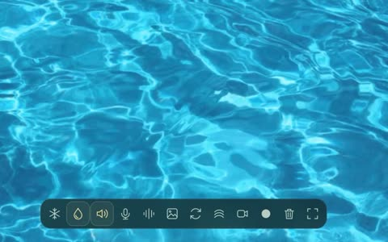
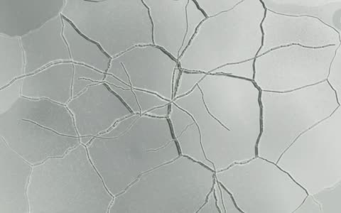
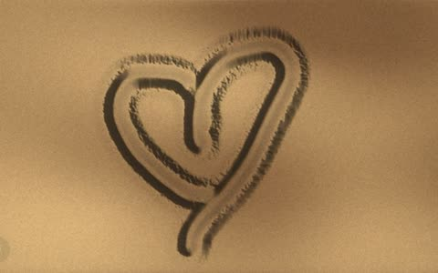
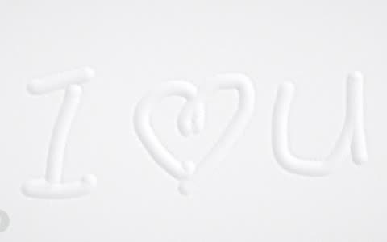
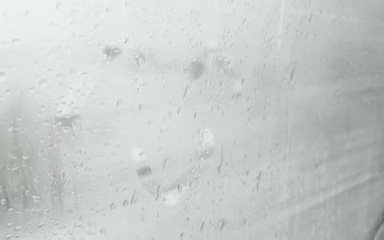

# Natural Effects

A growing collection of skills for creating interactive natural materials and motion.

These skills capture material behavior, implementation patterns, sound mappings, and lessons from iteration. They guide a coding agent's decisions; they are not a rendering library or a physically validated simulation package.

The collection grew out of [Natural Effects](https://naturaleffects.vercel.app/) (first titled States of Water): an exploration of familiar natural interactions as expressive surfaces. It now includes water, ice, condensation, sand, and snow.

| Water | Ice | Sand | Snow |
| --- | --- | --- | --- |
|  |  |  |  |

Stills from the Natural Effects app. The project began with a real fogged car window:



## Three connected layers

1. **Interaction:** turn sensed movement into stable contact signals.
2. **Materials:** define how each surface responds, sounds, and changes over time.
3. **Creative recipes:** combine these behaviors into drawing and storytelling tools.

## Skills

| Skill | Focus |
| --- | --- |
| [simulate-natural-water](skills/simulate-natural-water/SKILL.md) | Ripples, directional wakes, stirring, inertia, reflection, and refraction. |
| [simulate-natural-ice](skills/simulate-natural-ice/SKILL.md) | Faint friction writing, irregular growing fractures, and restrained material sound. |
| [simulate-natural-fog](skills/simulate-natural-fog/SKILL.md) | Fogged glass, narrow writing, broad wiping, and gradual recovery. |
| [simulate-natural-sand](skills/simulate-natural-sand/SKILL.md) | Granular furrows, displaced rims, settling, and movement-driven sound. |
| [simulate-natural-snow](skills/simulate-natural-snow/SKILL.md) | Dense powder texture, six-arm snowfall, dwell compression, settling, and fresh coverage. |
| [natural-motion-interaction](skills/natural-motion-interaction/SKILL.md) | Touch and camera input, contact lifecycles, gesture mapping, smoothing, and coordinate alignment. |
| [temporary-canvas](skills/temporary-canvas/SKILL.md) | A creative recipe connecting condensation, sand, and snow through temporary drawing. |

Material skills can be used independently. The motion skill provides shared input guidance while leaving each material free to respond differently.

## Use with Claude Code

Install all seven skills as a plugin (Claude Code 2.1.275 or later):

```text
/plugin install natural-effects --marketplace ambershen/natural-effect
```

On older versions, add the marketplace first, then install:

```text
/plugin marketplace add ambershen/natural-effect
/plugin install natural-effects@natural-effect
```

Plugin skills are namespaced, for example `/natural-effects:simulate-natural-water`. Claude also loads a skill on its own when your request matches its description.

To install individual skills instead, copy folders from `skills/` into `~/.claude/skills/` (all your projects) or `.claude/skills/` (one project).

## Use with Codex

Clone this repository and copy the desired folders from `skills/` into your Codex skills directory, normally `~/.codex/skills/` or `$CODEX_HOME/skills` when configured. Review existing folders before replacing a skill with the same name.

Once discovered by Codex, invoke a skill by name, for example:

```text
Use $simulate-natural-water to build a quiet water surface that responds to touch with directional wakes and decaying ripples.

Use $simulate-natural-fog with $natural-motion-interaction to create a fogged mirror: pinch to write, open palm to wipe, and release to stop.
```

## Structure

Each skill includes:

- `SKILL.md`: scope, material principles, workflow, and meaningful verification.
- `references/`: implementation notes, tuning examples, rejected approaches, and known limits.
- `agents/openai.yaml`: English discovery metadata and an example invocation.

All skill content is written in English. Numeric values describe particular studies rather than universal physical constants. Project-specific preferences are identified as such.

## Scope and source material

This repository contains skill instructions, reference notes, and original reusable snowflake SVG assets. The original application code, tracking models, and audio assets are maintained separately in the [Natural Effects application](https://github.com/ambershen/dirty-window). Source maps identify project-relative paths; the skills remain usable when that implementation is unavailable.

Reference notes distinguish accepted behavior from experiments. Breath detection remains experimental, and source or build checks alone do not establish natural sound, reliable gesture recognition, or physical accuracy.

Future skills can extend the collection to other materials and phenomena as working experiments provide useful, reusable lessons.

## Continuing the studies

Use the [iteration workflow](docs/iteration-workflow.md) to capture references, compare gestures, and promote reviewed lessons into skills. Keep accepted prototypes and open experiments separate. These documents describe reusable decisions; executable modules remain in the source application.

## License

[MIT](LICENSE). Reference photos and audio named in the study notes belong to their creators and are linked, not included.
